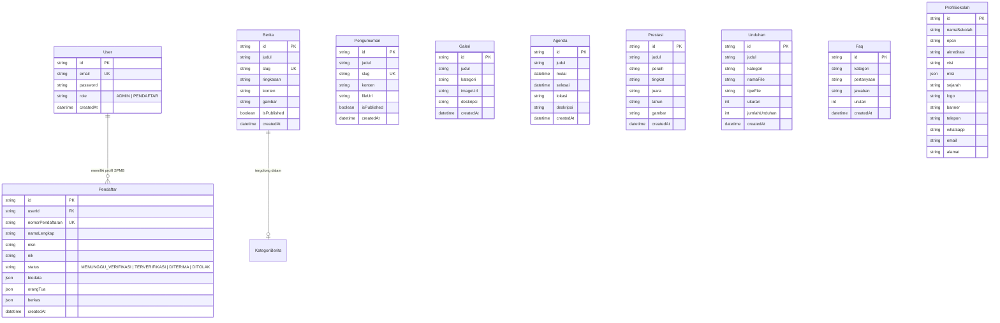

# Product Requirements Document (PRD)
## Sistem Informasi Madrasah & Portal SPMB (MTsN Wpendem)

- **Versi Dokumen**: 1.0.0
- **Status**: Aktif / Produksi
- **Terakhir Diperbarui**: 2026-10-29
- **Arsitektur**: Monorepo Modern (Client: React 19 + TanStack, Server: Express + Prisma + MySQL)

---

## 1. Ringkasan Eksekutif & Tujuan Produk

Aplikasi Sistem Informasi & Profil Madrasah ini dikembangkan untuk menyediakan portal digital resmi madrasah terintegrasi yang melayani tiga pilar utama:
1. **Portal Publik & Transparansi Informasi**: Menyajikan identitas resmi, profil kelembagaan, visi & misi, sejarah, struktur organisasi, fasilitas, berita editorial, pengumuman resmi, agenda kegiatan, galeri foto, prestasi santri, pusat unduhan, dan tanya jawab (FAQ).
2. **Portal SPMB (Sistem Penerimaan Murid Baru)**: Memberikan alur pendaftaran mandiri bagi calon santri dan orang tua murid secara digital, mulai dari pembuatan akun, pengisian biodata, unggah berkas persyaratan, pemantauan status verifikasi, hingga pencetakan bukti pendaftaran.
3. **Panel Admin & Pengelolaan Konten**: Menyediakan dasbor kendali operasional bagi staf madrasah untuk memverifikasi pendaftar SPMB, memutakhirkan profil lembaga, serta mengelola seluruh konten publik secara mandiri.

---

## 2. Arsitektur & Tumpukan Teknologi (Tech Stack)

### 2.1 Frontend (`/client`)
- **Framework & Core**: React 19, Vite 8 (ESM Native)
- **Routing**: `@tanstack/react-router` (Nested layouts, breadcrumb support, route guards)
- **Server State & Caching**: `@tanstack/react-query` v5
- **Styling**: Tailwind CSS v4 dengan identitas visual khas Kemenag:
  - `--color-brand`: `#14532d` (Hijau Kemenag)
  - `--color-brand-soft`: `#eef3ec`
  - `--color-canvas`: `#f5f3ee`
  - `--color-paper`: `#fffefb`
  - `--color-ink`: `#1c1b17`
- **Ikonografi**: `lucide-react`
- **Editor Konten**: `@tiptap/react` & `@tiptap/starter-kit`
- **HTTP Client**: `axios` dengan interceptor autentikasi otomatis

### 2.2 Backend (`/server`)
- **Runtime & Framework**: Node.js, Express.js
- **Database & ORM**: MySQL / MariaDB via Prisma ORM
- **Keamanan & Autentikasi**: JSON Web Token (Access Token + Refresh Token), `bcryptjs`
- **Penyimpanan Berkas**: `multer` untuk unggahan gambar berita, dokumen lampiran, berkas SPMB, dan foto galeri

---

## 3. Profil Pengguna & Hak Akses (User Personas)

| Peran (Role) | Deskripsi | Akses Utama |
|---|---|---|
| **Publik / Pengunjung** | Masyarakat, calon wali murid, dan pemerhati pendidikan | Halaman beranda, profil lembaga, berita, pengumuman, agenda, galeri, prestasi, pusat unduhan, FAQ. |
| **Pendaftar SPMB (Santri/Wali)** | Calon peserta didik baru yang mendaftar ke madrasah | Registrasi akun, login portal SPMB, formulir data diri, orang tua, asal sekolah, unggah berkas, cek status kelulusan/verifikasi. |
| **Administrator Madrasah** | Panitia SPMB, staf TU, dan humas pengelola madrasah | Dashboard statistik, modul verifikasi berkas pendaftar, manajemen berita, pengumuman, unduhan, galeri, prestasi, profil, dan FAQ. |

---

## 4. Kebutuhan Fungsional (Functional Requirements)

### 4.1 Modul Publik (Situs Utama)

#### A. Navigasi & Header
- **Desktop Navbar**:
  - Logo madrasah, nama instansi, nomor NPSN.
  - Menu beranda, berita, galeri.
  - Dropdown **Profil**: Visi & Misi, Sejarah, Struktur Organisasi, Fasilitas.
  - Dropdown **Layanan**: Pendaftaran SPMB, Pusat Unduhan, Tanya Jawab (FAQ).
  - Dropdown **Informasi**: Pengumuman, Agenda Kegiatan, Prestasi.
- **Mobile Navbar (`MobileNavbar.jsx`)**:
  - Drawer independen yang **meluncur mulus dari sisi kanan layar** (`translate-x-full` ke `translate-x-0`).
  - Dilengkapi backdrop blur gelap yang dapat diklik untuk menutup drawer.
  - Tombol tutup (**X**) di header drawer dan penanganan penutupan via tombol Escape.
  - Submenu akordeon interaktif untuk Profil, Layanan, dan Informasi.

#### B. Halaman Beranda (`Home.jsx`)
- **Hero Banner**: Menampilkan tagline institusi, deskripsi singkat madrasah, tombol aksi menuju pendaftaran SPMB dan profil, serta statistik ringkasan (akreditasi, NPSN, jumlah guru & siswa aktif).
- **Berita Terbaru**: Menampilkan kartu berita dengan grid 2 kolom di mobile dan 3 kolom di desktop, berskala 70% pada mobile untuk keterbacaan optimal.
- **Pengumuman Terbaru**: Menampilkan kartu edaran resmi dengan penanda lampiran dokumen.

#### C. Halaman Profil (`Profil.jsx`)
- **Header Bersih**: Menampilkan navigasi breadcrumb tanpa title/deskripsi berulang.
- **Visi & Misi**:
  - Dokumen institusional resmi tanpa kotak card.
  - Nomor urut berformat tipografi tegas khas instansi.
  - Pesan informatif rapi bila data belum tersedia.
- **Sejarah Singkat**: Narasi berdirinya madrasah disusun dalam format paragraf mengalir.
- **Struktur Organisasi**:
  - Susunan bagan kepemimpinan interaktif dengan foto pejabat madrasah.
  - Penataan bertingkat: Kepala Madrasah & Ketua Komite (Baris 1), 4 Waka & 4 Staf Tendik (Baris 2), Wali Kelas & Dewan Guru (Baris 3).
  - Skala kartu kompak 70% dengan horizontal scroll tanpa scrollbar pada layar ponsel.
- **Fasilitas Madrasah**:
  - Grid fasilitas 2 kolom pada mobile dan 3 kolom pada desktop.
  - Menampilkan thumbnail sarana, ikon kategori, dan nama fasilitas tanpa cuplikan deskripsi (deskripsi dialihkan ke halaman detail).

#### D. Halaman Berita (`Berita.jsx` & `BeritaDetail.jsx`)
- Toolbar pencarian instan berdasarkan judul atau isi artikel.
- Filter pill kategori berita dinamis (Semua, Akademik, Kesiswaan, Keagamaan, dsb.).
- Grid berita seragam (2 kolom di mobile, 3 kolom di desktop).
- Skala kartu berita pada ponsel 70% lebih proporsional (`NewsCard.jsx`).
- Halaman detail berita lengkap dengan foto tajuk, meta tanggal/penulis, tombol bagikan/salin tautan, serta kolom rekomendasi berita terkini.

#### E. Halaman Galeri Kegiatan (`Galeri.jsx`)
- Album dokumentasi foto kegiatan madrasah dengan filter kategori dan kolom pencarian.
- Kartu grid responsif (skala mobile 70% dengan tombol zoom overlay).
- Modal pratinjau foto resolusi penuh (lightbox) lengkap dengan deskripsi dan tanggal dokumentasi.

#### F. Halaman Pengumuman (`Pengumuman.jsx` & `DetailPengumuman.jsx`)
- Daftar surat edaran resmi madrasah dengan filter pencarian.
- Penanda keberadaan berkas lampiran (PDF, dokumen edaran).
- Halaman detail pengumuman yang menyediakan unduhan berkas lampiran resmi.

#### G. Halaman Agenda Kegiatan (`Agenda.jsx`)
- Tab pemisah antara *Agenda Mendatang* dan *Semua Agenda*.
- Blok visual tanggal (hari dan bulan) berstandar kalender instansi.
- Fitur simpan langsung ke kalender pengguna via berkas `.ics` (*iCalendar standard*).

#### H. Halaman Prestasi (`Prestasi.jsx`)
- Katalog raihan juara santri berjenjang (Sekolah, Kecamatan, Kabupaten/Kota, Provinsi, Nasional, Internasional).
- Penanda medali/gelar kejuaraan dan nama siswa peraih prestasi.

#### I. Halaman Pusat Unduhan (`Unduhan.jsx`)
- Repositori berkas formulir, panduan, dan regulasi madrasah.
- Ikon penanda tipe berkas otomatis (PDF, Word, Excel, PowerPoint, ZIP).
- Indikator ukuran file dan counter jumlah unduhan.

#### J. Halaman Tanya Jawab / FAQ (`Faq.jsx`)
- Akordeon tanya-jawab interaktif terbagi per kategori.
- Integrasi Schema.org `FAQPage` JSON-LD untuk optimasi SEO mesin pencari.
- Kartu CTA kontak langsung via WhatsApp/Email madrasah.

#### K. Footer Lembaga (`Footer.jsx`)
- Identitas lengkap madrasah, logo, NPSN, dan deskripsi institusi.
- Kolom tautan cepat (Berita, Pengumuman, Agenda, Prestasi).
- Kolom layanan (Pusat Unduhan, FAQ, Portal SPMB, Akses Pengelola).
- Informasi kontak resmi (telepon, WhatsApp, email) dan peta lokasi.

---

### 4.2 Modul Portal SPMB (Pendaftar)

1. **Registrasi & Otentikasi Pendaftar**:
   - Pembuatan akun santri baru menggunakan NISN/Email dan kata sandi aman.
   - Proteksi rute dengan `SpmbGuard`.
2. **Dashboard Pendaftar (`SPMBDashboard.jsx`)**:
   - Status seleksi pendaftar: *Menunggu Verifikasi*, *Terverifikasi*, *Diterima*, *Tidak Diterima*.
   - Informasi tahapan pendaftaran dan pengumuman jadwal seleksi.
   - Tombol cetak kartu tanda bukti pendaftaran.
3. **Formulir & Dokumen SPMB (`SPMBForm.jsx`)**:
   - Data pribadi calon siswa (NIK, NISN, nama lengkap, tempat/tanggal lahir, jenis kelamin, alamat).
   - Data orang tua / wali (nama ayah, ibu, pekerjaan, penghasilan, kontak wali).
   - Riwayat pendidikan asal (nama sekolah/madrasah asal, NPSN, tahun lulus).
   - Unggah berkas syarat (Pas foto, Kartu Keluarga, Akta Kelahiran, Rapor/Ijazah).
4. **Sidebar SPMB (`SPMBSidebar.jsx`)**:
   - Navigasi ringkas khusus pendaftar (*Dashboard* dan *Formulir & Dokumen*).

---

### 4.3 Modul Panel Admin (Pengelola)

1. **Otentikasi Pengelola**:
   - Login admin dengan token JWT ganda (Access Token berumur pendek + Refresh Token berkala).
   - Proteksi rute dengan `AdminGuard`.
2. **Dashboard Pengelola (`Dashboard.jsx`)**:
   - Metrik utama: Total pendaftar SPMB, pendaftar yang perlu ditinjau, total konten aktif, dan pesan kontak baru.
   - Tabel sebaran status pendaftaran SPMB beserta persentase porsi seleksi.
   - Tabel ringkasan kelengkapan profil sekolah dengan tautan langsung ke modul editor terkait.
3. **Manajemen Pendaftar SPMB (`AdminSPMB.jsx`)**:
   - Tabel data pendaftar dengan pencarian, filter status seleksi, dan penomoran.
   - Modal peninjauan berkas pendaftar dan penetapan status kelulusan.
   - Fitur ekspor data pendaftar.
4. **Manajemen Profil Lembaga**:
   - `AdminProfilIdentitas.jsx`: Nama lembaga, NPSN, akreditasi, tagline, deskripsi, logo, dan banner.
   - `AdminProfilKontak.jsx`: Nomor telepon, WhatsApp, email, alamat, dan link Google Maps.
   - `AdminProfilVisiMisi.jsx`: Editor teks visi dan susunan butir misi.
   - `AdminProfilSejarah.jsx`: Editor narasi sejarah berdirinya madrasah.
   - `AdminProfilStruktur.jsx`: Manajemen data pejabat, guru, dan staf (nama, jabatan, foto, urutan bagan).
   - `AdminProfilFasilitas.jsx`: Manajemen unit sarana madrasah (nama, foto, kategori ikon, deskripsi).
5. **Manajemen Konten Publik (CMS)**:
   - Modul CRUD lengkap untuk Berita, Pengumuman, Agenda, Prestasi, Unduhan, Galeri, dan FAQ.
   - Editor artikel TipTap dengan dukungan format teks tebal, miring, list, kutipan, dan penyisipan gambar.
6. **Kotak Masuk Kontak (`AdminPesanKontak.jsx`)**:
   - Menampung seluruh pesan pertanyaan yang dikirimkan publik melalui formulir kontak/FAQ.

---

## 5. Kebutuhan Non-Fungsional (Non-Functional Requirements)

### 5.1 Desain & Pengalaman Pengguna (UI/UX)
- **Desain Bersih & Khidmat**: Palet warna institusi keagamaan resmi (Forest Green, Gold accent, Warm Paper background).
- **Proporsi Mobile**:
  - Ukuran card fasilitas, berita, dan galeri diskalakan **70% lebih ramping** pada layar smartphone.
  - Sembunyikan scrollbar (`no-scrollbar`) pada seluruh form isian data dan tabel sempit untuk mencegah kekacauan layout visual.
- **State Data Kosong & Error Terpadu**:
  - Jika data belum diinput, tampilkan pesan institusional spesifik: `[Nama Data] belum tersedia.` tanpa kotak dashed tebal atau font miring.
  - Ketika terjadi kegagalan pengambilan data dari server, gunakan komponen notifikasi bawaan:
    ```jsx
    <Alert tone="error">{errorMsg}</Alert>
    ```

### 5.2 Keamanan & Integritas Data
- Password pengguna di-hash menggunakan algoritma `bcrypt`.
- Verifikasi otorisasi pada endpoint sensitif menggunakan Bearer JWT middleware.
- Sanitasi input form dan pembersihan tag berbahaya pada konten HTML (`stripHtml` / `sanitizeHtml`).
- Pembatasan tipe mime dan ukuran berkas maksimum pada pengunggahan gambar dan dokumen.

### 5.3 Kinerja & Kompatibilitas
- Code-splitting berbasis rute dengan TanStack Router untuk mempercepat *First Contentful Paint* (FCP).
- Strategi caching data publik melalui TanStack Query dengan revalidasi pintar di latar belakang.
- Responsif penuh di berbagai ukuran layar: Desktop (>= 1024px), Tablet (640px - 1023px), dan Ponsel (< 640px).

---

## 6. Struktur Skema Database Utama (Prisma)



---

## 7. Rencana Rilis & Pemeliharaan

1. **Fase 1 (Selesai)**:
   - Migrasi arsitektur ke monorepo TanStack (Router & Query).
   - Penyesuaian layout publik standar Kemenag (Breadcrumbs bersih, heading institusional, grid 2 kolom mobile berskala 70%).
   - Pembagian modul `Navbar` dan `MobileNavbar` (drawer slide-in dari kanan).
   - Standardisasi pesan kosong `[Item] belum tersedia.` dan integrasi `<Alert tone="error">`.
2. **Fase 2 (Berjalan)**:
   - Finalisasi repositori Git monorepo (`.gitignore`, `.env.example`, `PRD.md`).
   - Pengujian berkala pada alur SPMB pendaftar dan verifikasi dokumen admin.
3. **Fase 3 (Mendatang)**:
   - Integrasi gerbang notifikasi WhatsApp otomatis untuk pembaruan status kelulusan SPMB.
   - Penambahan fitur ekspor laporan pendaftar berformat spreadsheet Excel (`.xlsx`).
   - Backup basis data terjadwal otomatis.
